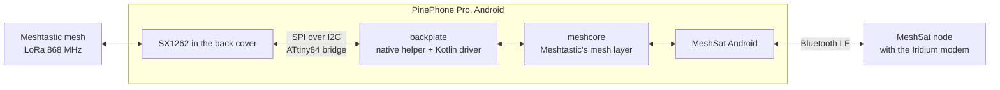

<picture>
  <source media="(prefers-color-scheme: dark)" srcset="docs/images/mark-dark.png">
  
</picture>

### The MeshSat Android app as a Meshtastic node, on a PinePhone Pro with the LoRa back cover.

[MeshSat Android](https://github.com/meshsat/meshsat-android) ·
[MeshSat node](https://github.com/meshsat/meshsat-esp32) ·
[What is proven](#what-is-proven-and-what-is-not) ·
[meshsat.net](https://meshsat.net)

[MeshSat Android](https://github.com/meshsat/meshsat-android) is a Meshtastic client: it talks to a node over Bluetooth, and the node runs the mesh. This repository gives the app a radio of its own. On a PinePhone Pro running Android, with Pine64's LoRa back cover on, the app drives the cover's SX1262 directly and speaks Meshtastic's LoRa protocol itself, so the phone is a node without any other hardware.

Two pieces, both in Kotlin:

- **backplate**: the back cover's I2C-to-SPI bridge and the SX1262, from a small native helper that owns the I2C device up to a radio that sends and receives LoRa frames with Meshtastic's settings.
- **meshcore**: Meshtastic's mesh layer, the part that turns frames into messages between nodes. Packet header, channel keys and encryption, the data protobuf, duplicate detection, hop limits, acknowledgements, node and position broadcasts.

The app then gets a choice: a Bluetooth node, or this phone's own radio.

> **Status: pre-release.** This is a prototype under active development, not a finished product. Nothing here has run on hardware yet. Meshtastic's mesh layer lives in its firmware; this is a fresh implementation of the parts a phone needs, and it will be behind the firmware for a long time. It has never been deployed to a real user and has never been used in an actual emergency. See [What is proven, and what is not](#what-is-proven-and-what-is-not) before you rely on it for anything.

## How it fits together

## Android on the PinePhone Pro

The only Android for this phone is [GloDroid](https://github.com/GloDroidCommunity/pine64-pinephonepro), a community build of AOSP. Its last release dates from 2023 and its own notes say it is not recommended for daily use. It boots from an SD card, which leaves Linux on the phone's storage untouched, and it can be rooted, which this project needs to reach the I2C device. What works and what does not on the build used here is recorded in `docs/GLODROID.md` once the first bring-up has run.

## What is proven, and what is not

|                                                              | State             |
| ------------------------------------------------------------ | ----------------- |
| GloDroid booting on the PinePhone Pro, with root             | **Not tried yet** |
| MeshSat Android running there, paired with a node over Bluetooth | **Not tried yet** |
| The back cover's radio driven from the app                   | **Not built yet** |
| A frame from another Meshtastic node received and decoded    | **Not built yet** |
| A text sent from the phone arriving on another node          | **Not built yet** |
| Direct messages with Meshtastic's public-key encryption      | **Not built yet** |
| Deployment to a real end user                                | **Never**         |
| Use in an actual emergency                                   | **Never**         |

## Related projects

- **[MeshSat Android](https://github.com/meshsat/meshsat-android)**, the app this gives a radio to
- **[meshsat-lora-backplate](https://github.com/meshsat/meshsat-lora-backplate)**, the same back cover under Linux, through Meshtastic's own daemon
- **[MeshSat node](https://github.com/meshsat/meshsat-esp32)** and **[meshsat-firmware](https://github.com/meshsat/meshsat-firmware)**, the reference nodes this phone is tested against
- **Pine64's PineDio**: the [back cover](https://wiki.pine64.org/wiki/Pinedio) and [JF002's driver](https://codeberg.org/JF002/pinedio-lora-driver), which documents the bridge

## Licence

GPL-3.0, like the rest of MeshSat. Meshtastic is a registered trademark of Meshtastic LLC; this project is not affiliated with it.
